> 调研与整理：2026-11-19。班期时刻与价格来自爱达邮轮官网（adoracruises.com）当日查询，促销价随活动变动，预订时以官网/预订页为准。

## 一、结论速览

2027 年春节是 **2 月 6 日（正月初一）**，除夕 2 月 5 日，法定假期预计 2 月 5 日–13 日。

| 船 | 出发 | 航线 | 官网价（含税） |
|---|---|---|---|
| **爱达·花城号** | 2/6（初一）广州南沙 | 广州→顺化(真美)→下龙湾(蔡澜)→广州，6天5晚 | ¥4,049.25/人起（指导价 ¥6,199）；标准内舱 ¥4,049.25 / 舒适内舱 ¥4,074.25 / 高区优选内舱 ¥4,124.25 |

- 这是花城号**春节唯一航次**（曾见代理页面把同一天挂出多条航线，均为模板复用错误，官网船期已核实只有一条）；2/11（初六）清晨回广州，完整覆盖假期前六天。
- 初一 18:00 在广州南沙登船起航，**在船上过初一**；初二全天海上巡航。
- 春节正班相对错峰班溢价约 2 倍上下；同舱第三/四人有优惠（以预订页为准）。
- 花城号是爱达邮轮 2026 年 11 月 22 日新下水的第二艘国产大邮轮：14.19 万总吨、341 米长、2130 间客房，满载 5232 人。

## 二、官方逐日时刻

| 天 | 日期 | 港口 | 抵达 | 起航 |
|---|---|---|---|---|
| 1 | 2/6 周六（初一） | 广州南沙国际邮轮母港 | — | **18:00** |
| 2 | 2/7 周日（初二） | 海上巡航 | — | — |
| 3 | 2/8 周一（初三） | 顺化·真美港（Chan May） | 06:00 | 16:00 |
| 4 | 2/9 周二（初四） | 下龙湾·蔡澜港（拜寨） | 10:00 | 20:00 |
| 5 | 2/10 周三 | 海上巡航 | — | — |
| 6 | 2/11 周四（初六） | 广州 | **06:00** | — |

### ⚠️ 特别提示：撞上越南 Tết

2027 年越南农历新年（Tết）同样是 2 月 6 日，本航次的两个岸上日（2/8、2/9）正值越南 Tết 假期的初三、初四：

- 主要景点（顺化皇城、下龙湾游船）通常照常开放，皇城一带还有 Tết 节庆活动，古镇灯笼年味浓；
- **部分小店、小餐馆可能歇业或缩短营业**；就餐优先选景点周边大店或船方岸上游含餐；
- 岸上人流可能多于平日，出发前在船上岸上观光台确认当日安排。

## 三、2/8 顺化·真美港（在港 10 小时）

交通基础数据：真美港→顺化古城约 60-65km / **1.5h**；→岘港约 45km / 1h；→会安约 70-75km / **1.5-2h**（全程非高速）。落地签 HK$119/人由船方统一代办（信息不符会产生 HK$280/人加急费）。2 月 19~25℃，温暖偶有小雨。

### 方案A：顺化古都线（春节避开皇陵类景点，以皇城、寺庙、市集为主）

| 时间 | 安排 | 要点 |
|---|---|---|
| 06:00–06:45 | 早餐+下船通关 | |
| 06:45–08:15 | 车赴顺化 | |
| 08:15–10:45 | **顺化皇城**（UNESCO） | 午门、太和殿、紫禁城；门票约 20 万越南盾（≈¥60）；Tết 期间皇城常有节庆布置 |
| 10:45–11:30 | **东巴市场**午餐 | 顺化牛肉粉、bánh khoái 小食拼盘；年节市集最热闹 |
| 11:30–12:15 | **长钱桥**拍照 + 老城三轮车 | 桥畔即香江，30 分钟 |
| 12:15–13:00 | **天姥寺** | 香江边七层福缘塔（车程约 20 分钟）；进寺勿穿短裤短裙 |
| **13:00 必须发车** | 返程 | 14:30 到港，留足缓冲 |
| 15:15 前 | 登船 | 16:00 起航 |

时间富余可在 11:30–12:15 段改去**安定宫**（南芳皇后旧居，黄色法式宫殿，出片）。

### 方案B：会安+岘港线（时间偏紧，出片亲子向）

| 时间 | 安排 | 要点 |
|---|---|---|
| 07:00–09:00 | 车赴会安 | |
| 09:00–12:30 | **会安古镇** | 联票约 15 万越南盾（≈¥45）含日本桥、福建会馆、进记古宅等 5 点；Tết 期间古镇灯笼氛围浓；高楼面、白玫瑰虾饺、法棍；可加迦南岛簸箕船（30-45 分钟） |
| 12:30–13:15 | 会安午餐 | **13:15 必须发车** |
| 13:15–14:45 | 回程途经岘港停 30 分钟 | 龙桥拍照、美溪沙滩 |
| 15:15 前 | 登船 | |

> **关键提醒**：自由行船不等人，只有报**船方岸上游**才有误船保障。参考：皇家加勒比同港最便宜的"会安接送+门票"岸上游约 US$45.75/人（邮轮游客实付记录）；爱达价格上船后以船方公布为准。带老人小孩或不想操心 → 官方岸上游。

## 四、2/9 下龙湾·蔡澜港（在港 10 小时）

2 月下龙湾 15~20℃ 偏凉、海面常起雾——雾中喀斯特如水墨画，不影响游船，带外套。

### 方案A：下龙湾日游船（绝大多数人的选择）

| 时间 | 安排 |
|---|---|
| 10:00–11:00 | 下船，至拜寨游船码头（蔡澜港就在拜寨旅游区旁，步行/短途打车） |
| 11:00–16:30 | 日游船约 5.5 小时：斗鸡石、香炉石 → **惊讶洞** 45 分钟 → **月亮湖**皮划艇/竹篮船 40 分钟 → **天堂岛(Titop)** 1 小时（爬 400+ 级台阶上观景台俯瞰全湾，或沙滩休息）；船上海鲜午餐 |
| 17:00–18:30 | 拜寨海滩 / Sun World 广场，越南滴漏咖啡 |
| 19:30 前 | 登船，20:00 起航 |

预订：船方岸上游（上船后订）或 Klook/KKday 日游船产品，参考价 ¥200-400/人（以实时价为准）。天堂岛台阶陡，穿防滑鞋。

### 方案B：缆车+陆地线（晕船/带娃家庭）

| 时间 | 安排 |
|---|---|
| 10:30–11:00 | 打车约 10 分钟到 Sun World 下龙园区 |
| 11:00–12:00 | **皇后缆车**（创纪录跨海缆车，单厢载 30 人）跨海到巴堆山 |
| 12:00–16:00 | 山上禅园、**太阳轮摩天轮**俯瞰全湾；下山逛拜寨海滩 |
| 17:30–19:00 | 下龙湾夜市海鲜；越南咖啡、腰果、漆器伴手礼（Tết 期间部分摊位可能歇业，以现场为准） |
| 19:30 | 回船 |

缆车+山顶园区为套票制，票价以 Klook 或当地实时价为准（调研时未能核实，标注存疑）。

## 五、小红书笔记图文实录

以下为 2026-11-19 登录态采集的小红书真实笔记图文（标题/作者/正文摘录/配图）。因小红书链接带时效 token 无法直接外链打开，图文已转载存档至本站并注明出处，版权归原作者，侵删联系博主。

### 「爱达花城号」首航体验vlog｜邮轮研学之旅

*作者：张有伯📷｜发布：编辑于 昨天 21:18 上海｜来源：小红书（2026-11-19 采集）*

> 继「爱达魔都号」后的第二艘、更大的「爱达花城号」终于在上海下水啦，由于要在花城——广州运营，所以第一程就是要从上海开往广州，对于这次的试运营航线，广州的11个区分别对接了华东15所高校，邀请了近千名学生参与这场研学活动。 很高兴这次可以作为华东师范大学的一员参与邮轮研学旅行，记录下了难忘的风景和瞬间，那就请大家和我一起开启这趟旅程吧！ 设备：索尼A7M5，16-35GM2，富士GFX100s2，中一45/1.4，大疆Pocket4P，哈苏501C #邮轮 #vlog #游轮 #沉浸式旅游 #拥抱旅程探索世界 #爱达花城号 #电影感 #华东师范大学 #一种很新的旅行记录方式 #RED视频创作计划

---

### 越南真美港：跟团接驳车、包车血泪避坑实录

*作者：恬恬和她爸妈(孕期版)｜发布：05-09｜来源：小红书（2026-11-19 采集）*

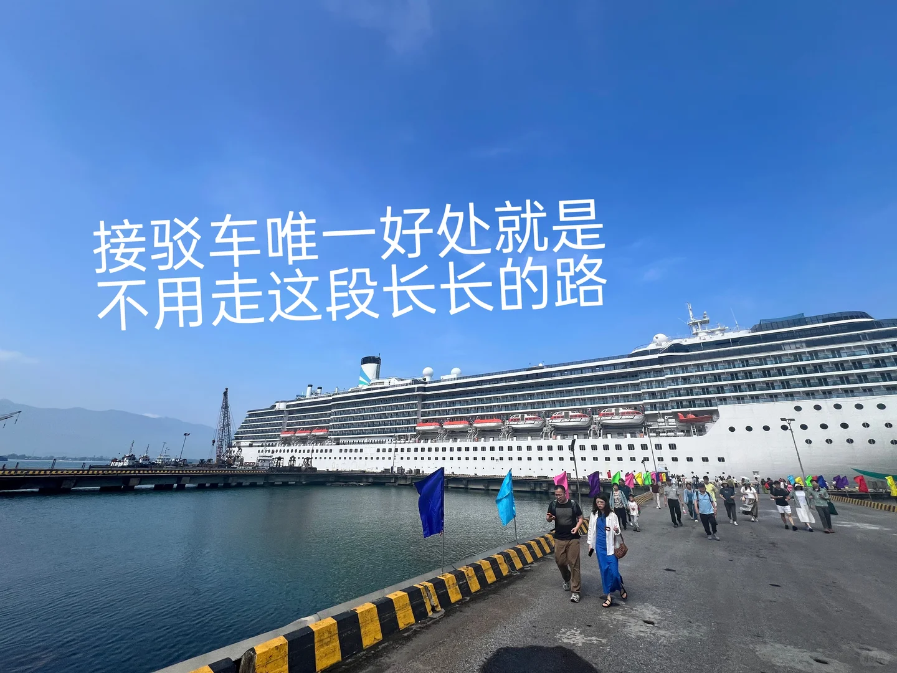

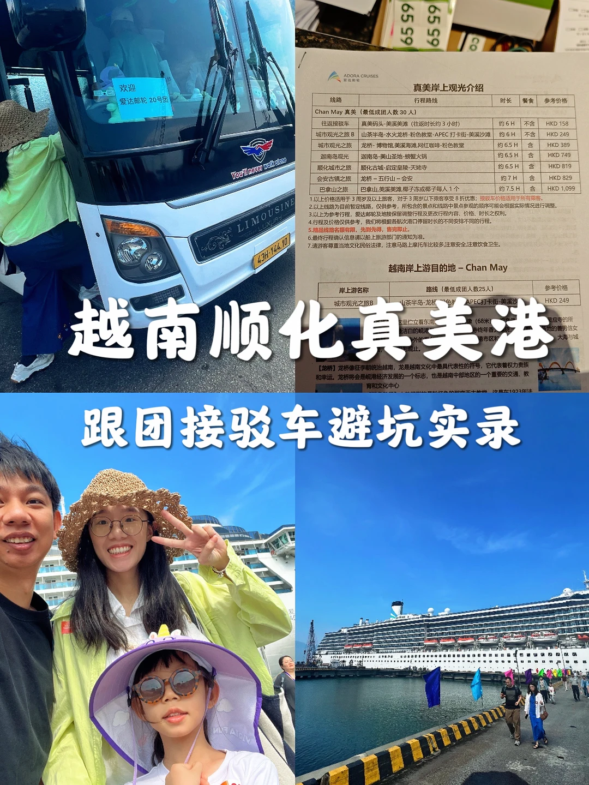

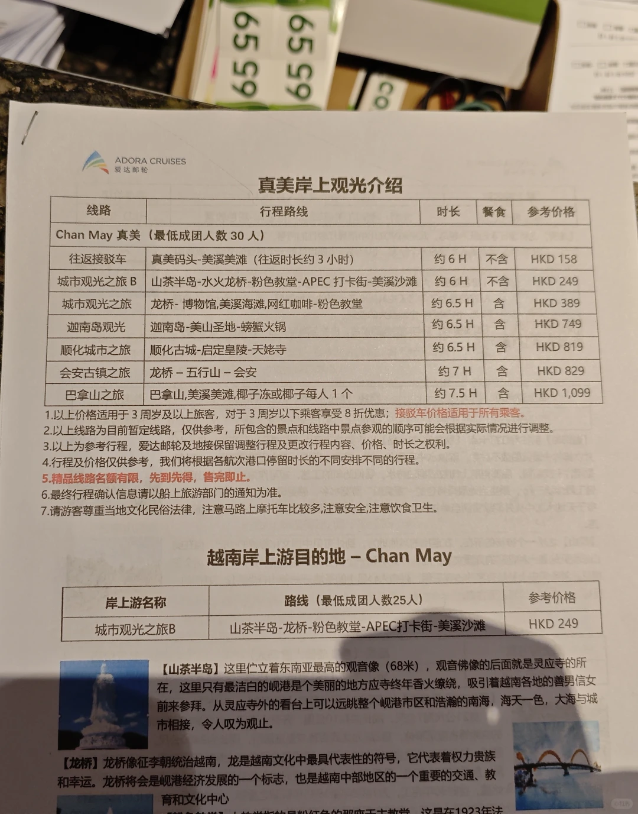

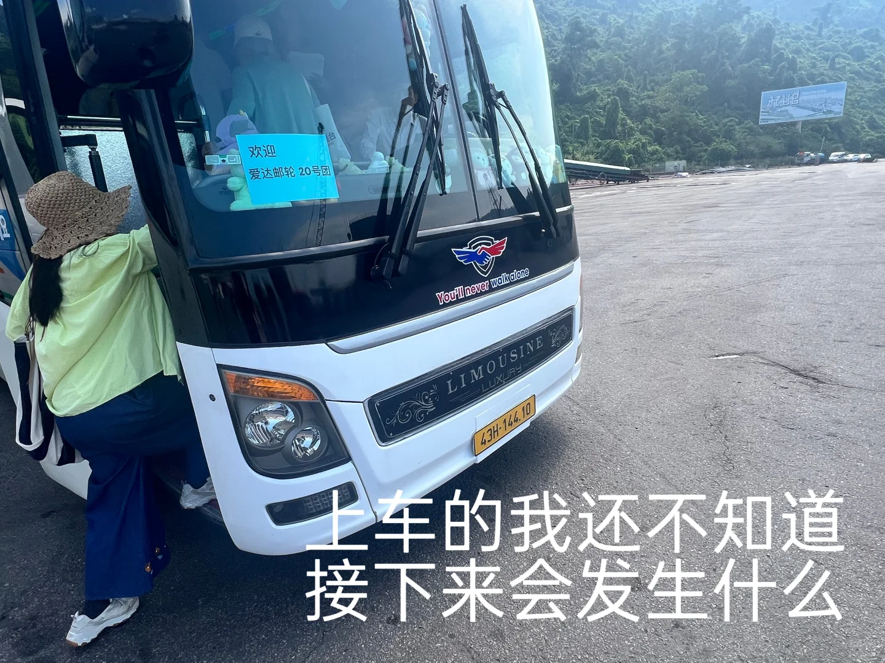

> 🤗我们五一邮轮游，路线是广州南沙———越南顺化真美港——香港——南沙 如果你也计划在真美港上岸去玩，这篇值得看完。 👯原本的计划 真美港上岸，叫GRAB去岘港（约1小时），在岘港租电车，骑去山茶半岛，再骑车回来岘港市区逛吃逛吃，最后去美溪沙滩躺平+玩沙的。玩到晚上7点前回船，美滋滋。 😡前一晚的大无语事件 上岸前一晚，我老公听完邮轮工作人员介绍，突然慌了——说真美港出口被黑车包围，打车要等很久；或者只能上黑车，一上车就被要求包车。他担心叫不到Grab，非要报团里的接驳车。 😡😡😡更气的是：这是他听完介绍、距离报名截止只剩半小时说的。根本来不及查证或商量。 😭那晚看表演我都黑着脸，回房间大吵一架。 我生气的点是，去哪里玩吃什么都是我做的攻略，就让他负责交通这块，出发前我反复说“如果港口不好打车，我们就提前找人拼车”。他信誓旦旦说可以，结果临出发这样，真的气死人，好生气好生气，一晚上不能平复。 😡😡😡😡😡😡跟团果然被坑（哪怕只是接驳车） 明明说好7点前回轮船即可😡 结果上车没多久，越南导游就说：“因为4.30-5.3是越南解放日假期，岘港市区有活动，可能封路、大堵车，所以公司要求回程必须提前到下午3:45。”😡😡😡😡 ？？？那还有几个小时玩？所有行程都得再缩短😡 更气的是——回程一路通畅，比去程还快，我们下午5点就到码头了。😲 说好的封路呢？堵车呢？根本就是找借口压时间。 算下来，白白少了2个小时的游玩时间。😡 回到码头发现，所有提前回来的全是跟团的。自己包车或打车的，也有人说被越南司机以“no time no time”为由早早送回。事实上回程完全不塞车。 总结教训 要么坚持原计……

---

### 真美港邮轮一日游路线推荐

*作者：loopy越南行｜发布：编辑于 5天前 上海｜来源：小红书（2026-11-19 采集）*

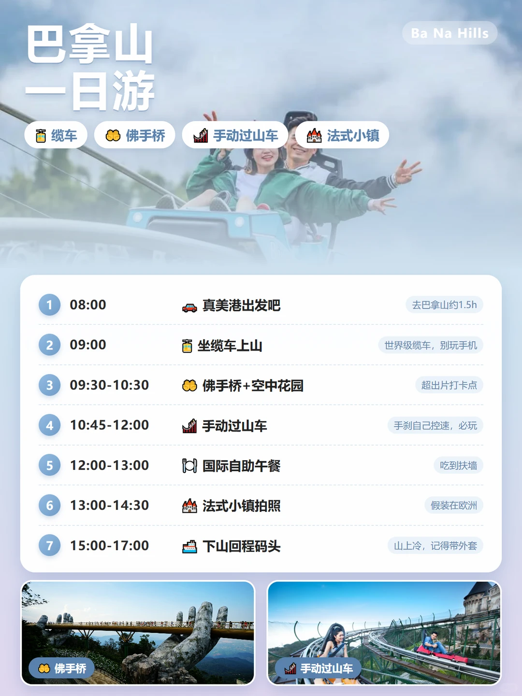

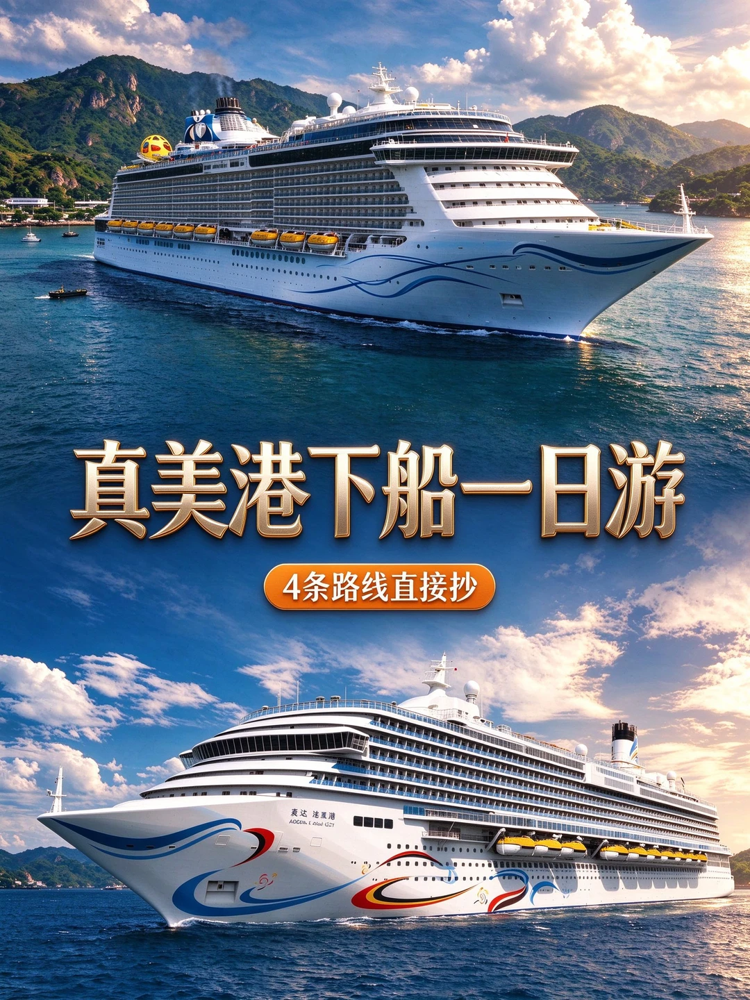

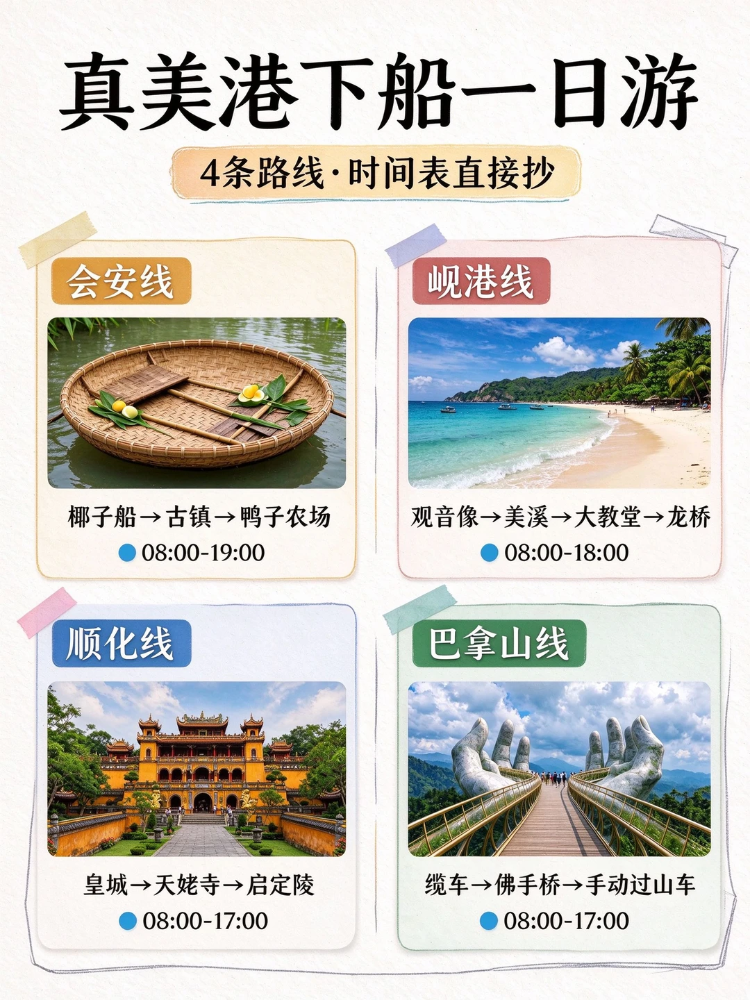

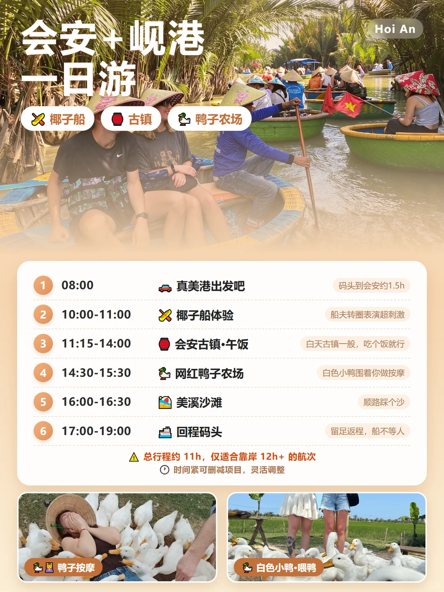

> 🇻🇳 邮轮停真美港，下船别乱走 真美港（Chan May）在顺化市，越南中部邮轮的主要停靠港，靠岸通常 8-12 小时。光谱号、爱达号、鼓浪屿号等东南亚航线常停这里。 📍 方位先搞清（不堵车） 顺化市区 45 分钟｜岘港 1.5 小时｜会安 1.5-2 小时｜巴拿山 2 小时 ⚠️ 回船看“船时”不是当地时间：越南比国内慢 1 小时。 🗺️ 4 条线，按靠岸时长选 1️⃣ 会安线｜椰子船为核心，其余做减法 椰子船别按 40 分钟算：船程 40 分钟+换装拍照，留 1-1.5 小时。 12h+：椰子船→古镇+午饭→鸭子农场→美溪沙滩 9-10h：椰子船→古镇+午饭（砍鸭子农场、美溪） 8h：椰子船→河边快速午饭，12:30 返程 船夫的椰子船转圈表演是招牌 2️⃣ 岘港市区线｜需 10 小时，带老人小孩首选 灵应寺观音像 30 分钟→美溪海滩 2 小时→海鲜午饭→粉红教堂 30 分钟→龙桥 30 分钟 美溪沙细水缓，值得多待；龙桥喷火只在周末晚 9 点，白天只能看桥。 3️⃣ 顺化古都线｜需 9 小时，船期最短选它 皇城 2 小时→午饭→天姥寺 1 小时→启定陵 1 小时 离港口最近，8 小时靠岸也能跑，最稳。 4️⃣ 巴拿山线｜需 11 小时以上 缆车→佛手桥+空中花园 1 小时→手动过山车 1 小时→自助午餐→法式小镇 1.5 小时 手刹自己控速别放飞；山顶比山下低 5-8℃，带外套；缆车常排 30 分钟（赶时间可购买快速通道）。 🆚 包车 vs 船上产品 价格：船上按人头，包车按整车，3 人以上分摊人均更低 时间：包车按你的靠岸时间排，能延长景点、跳过购物点 省心：船上产品……

---

### 国庆会安一日游|岘港第3日

*作者：虾米酱｜发布：03-15｜来源：小红书（2026-11-19 采集）*

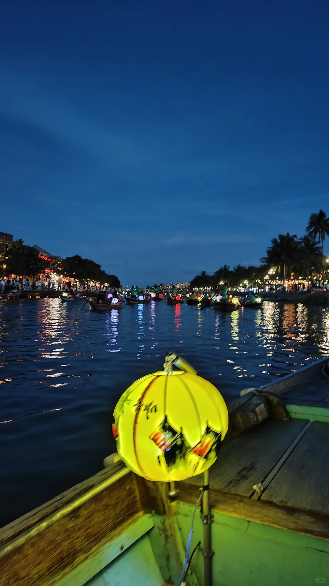

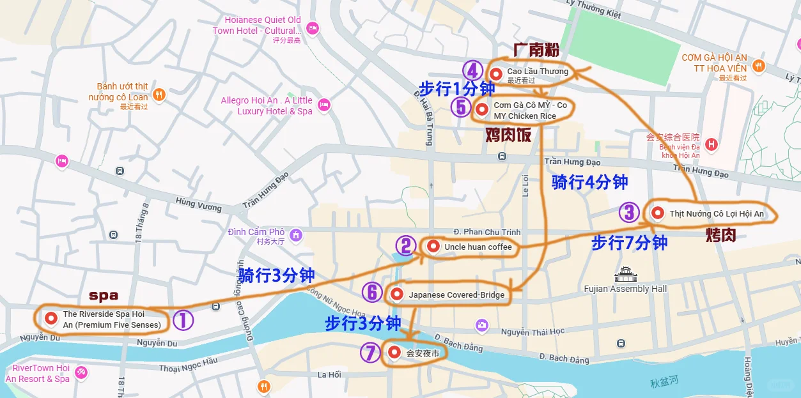

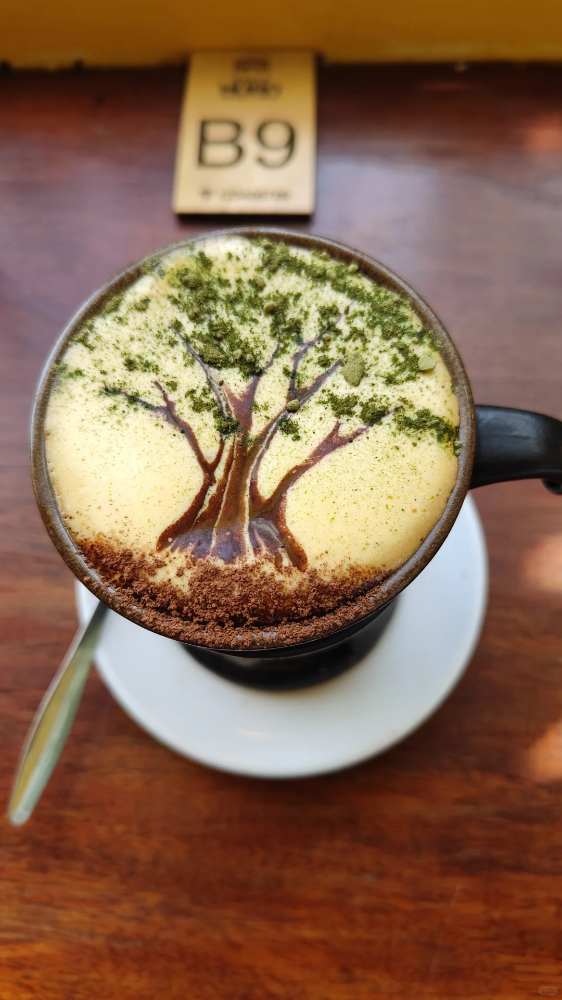

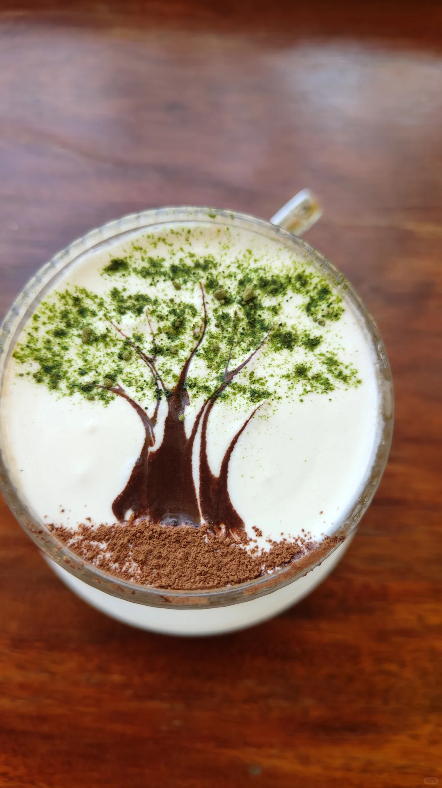

> 1.早餐：广南面Quán mỳ quảng Bà Minh 广面是岘港的特色，去椰子船特地找了家顺路又高评分的店，从酒店骑电动车过去大概13min 点了两个特别碗，一个虾一个牛肉，都是35k一碗，感觉和我们平常吃的河粉没什么区别，整体味道是甜咸的，风格和捞河粉特别像，实话说我觉得我们的荔林至尊三宝捞河比它好吃多了 2.椰子船 广南面骑车过来31分钟 详细体验请看下一篇 3.The Riverside Spa Hoi An按摩 从椰子船骑车过来15分钟，门外可以停电动车 很舒服的店，具体体验请看下一篇 4.Uncle huan coffee 要了一杯盐咖啡和热的鸡蛋咖啡，拉花确实很漂亮，两杯喝着味道也很不错，坐在室外，吹着微风，喝着咖啡，看着楼下，很是惬意 5.午餐Thịt Nướng Cô Lợi Hội An烤肉 路边摊，我是下午三四点的时候吃，人不多 一份10串烤肉是100k，包含10张米皮、蔬菜和蘸酱 非常好吃，是这次在越南吃过好吃的排前三的东西，烤肉很香，带点甜，米皮包裹着烤肉和青瓜蘸点酱简直太满足，两个人吃一份其实已经够了，不过瘾又追加了半份，吃着很爽 强烈推荐 6.闲逛会安至晚饭 7.晚餐1：Cao Lầu Thương 吃会安特色，高楼面的地方 点了高楼面和叉烧面，都是30k一份 说是面，但其实像桂林米粉的粉，味道一般，尝试即可 8.晚餐2：Cơm Gà Cô MỲ - Co MY Chicken Rice 吃会安特色鸡肉饭的地方，路边摊，一份只要25k 一份饭，有碎鸡肉、洋葱、不知道什么的绿叶和一碗鸡杂汤 鸡肉挺嫩的，汤很好喝，分量还可以，而且老人家两口子虽然有……

---

### 会安 | 被评为人生必去的50个地方之一

*作者：iPung｜发布：05-31｜来源：小红书（2026-11-19 采集）*

> 白天是明黄色的复古小镇🟡 夜晚已是一片灯笼的海洋🏮 不敢相信会安的白天和夜晚完全是两个世界 椰子船🛶一定要来体验 去了现场椰子船门票价格不一 可以和船夫砍价 谈到两个人15万🇻🇳越南盾 全程大概40分钟左右 穿过茂密的水上原始椰林 🌴 在广阔的水域上 🌇落日后的蓝调时刻真的很治愈 #越南 #越南旅游 #小众目的地旅行 #会安 #会安古镇 #一生中值得去旅游的地方 #人生必去的景点 #东南亚旅游 #椰子船 #旅行推荐 @薯条小助手

---

### 顺化皇城｜拍了好多画面，想慢慢讲给你们听

*作者：花栗鼠的旅行记｜发布：2天前 辽宁｜来源：小红书（2026-11-19 采集）*

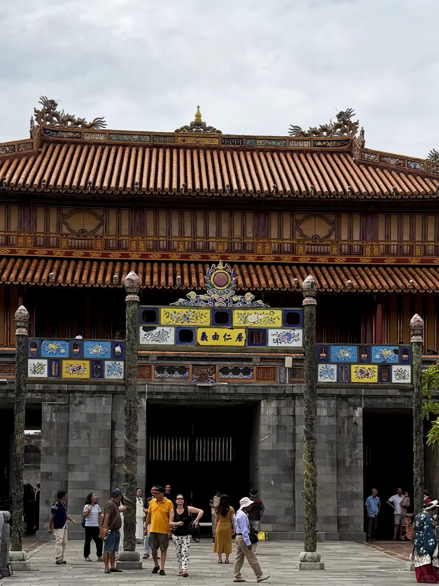

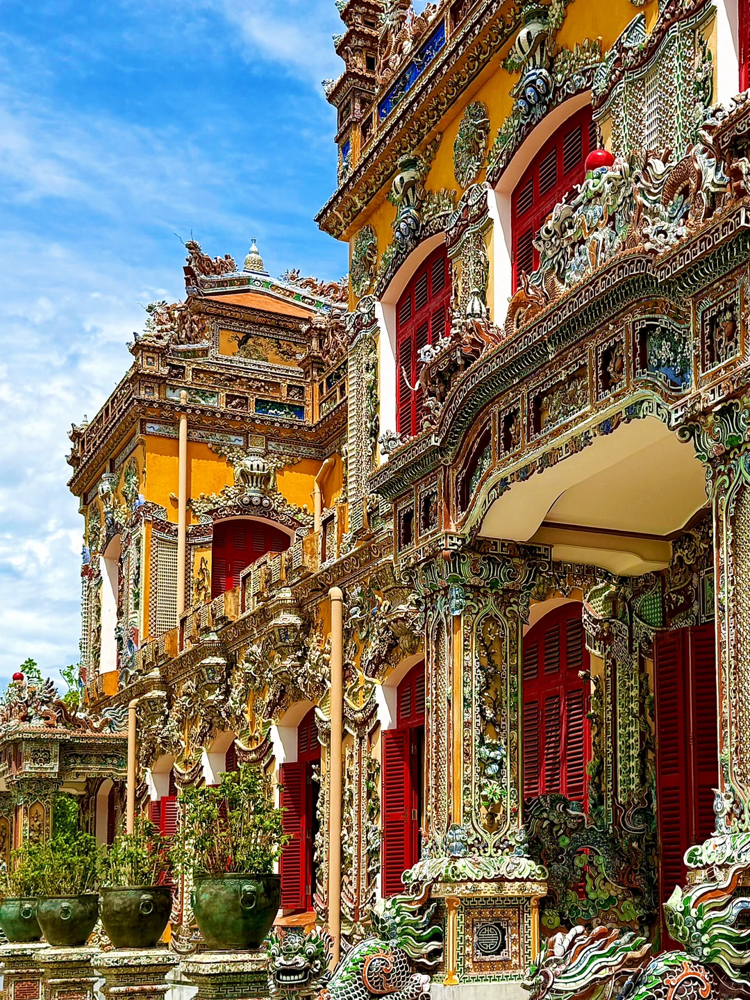

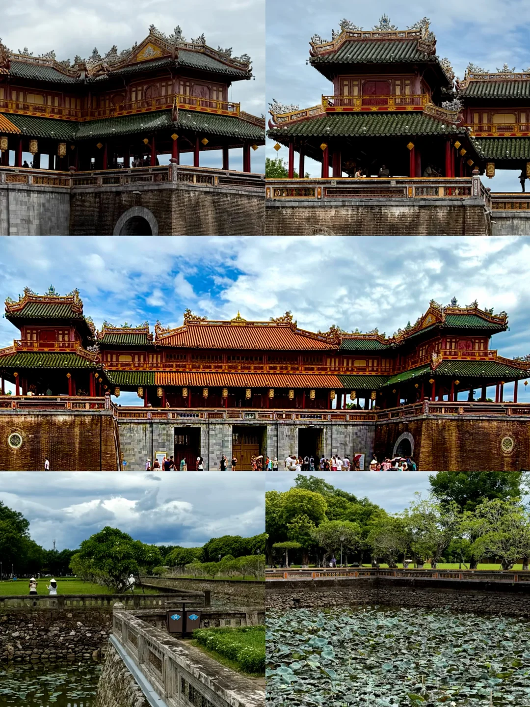

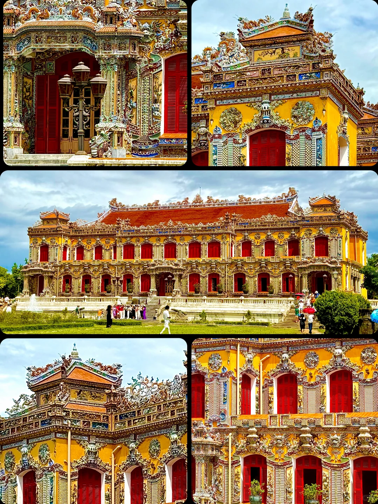

> 家人们想你们啦！今天晴天🐹和小葵🐹走进越南顺化皇城。 这里是越南最后一个封建王朝阮朝的都城。1802 年阮福映建立阮朝，1804 年定都顺化。皇城之内还有大内禁城层层嵌套，建筑格局参考明清的古建礼制。午门、金水桥、太和殿，一眼就能看见熟悉的东方影子。历经多次战火，不少殿宇没能留存至今，一部分经过修缮，静静伫立在这里。 一边是红漆庄重、飞檐整齐的大殿，古朴沉静；另一边留存着旧时的台基，野草从石头缝里慢慢长出来。那些遗留的柱础，还在悄悄告诉我们，从前这里楼阁连片，热闹非凡。 漫步其间，能看见不少游客身着飘逸奥黛，在宫廊与殿宇间取景拍照。衣袂轻轻拂过古老石阶，现代的游人遇上百年宫阙，有一种古今交汇、恍如隔世的奇妙氛围感。 让人印象深刻的是建忠殿。中式屋顶，配上法式彩色玻璃窗，两种风格安安稳稳融在一栋房子里。阳光穿过彩窗，在地上洒下一片花花的光影，四下安安静静。站在这里发呆的时候，我总在想，百年前住在宫里的人，也会看这样的落日吗？ 看多了各地古迹，我慢慢懂得：顺化皇城的美，是温润的、带着时光沉淀感的。繁华褪去，归于平和。 来顺化，留一点时间，好好听听这座皇城的故事。你们逛古建的时候，会不会也沉醉在这种岁月感里？ 我们是爱旅行的晴天🐹和小葵🐹，持续分享旅行浪漫，记得关注哦，滋儿～ #小众旅行地 #一万种旅行howto #越南 #世界文化遗产 #落地签共建计划 #假日citywalk #周末去哪儿 #人文摄影 #小红书影像激励 #旅游编辑部

---

### “海上桂林”下龙湾一日游，保姆级攻略

*作者：逗逗逗你玩～｜发布：01-25｜来源：小红书（2026-11-19 采集）*

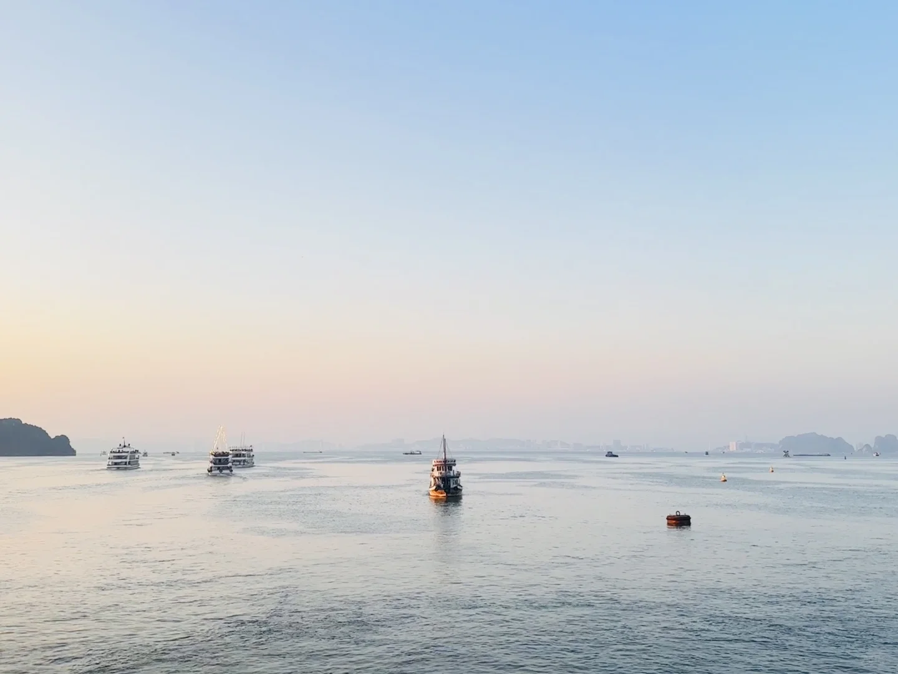

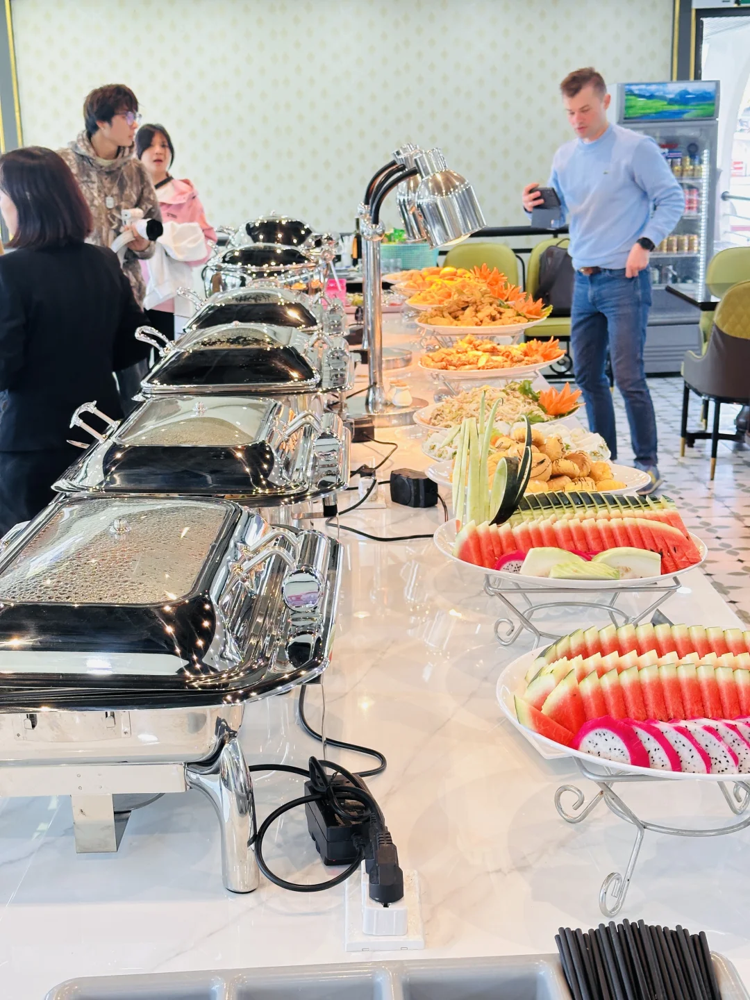

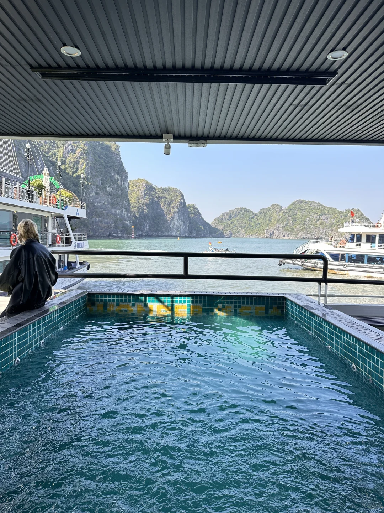

> 🚢关于报团： 出发前国内各种APP上看最便宜的五星游轮一日游价格要三百七八了，决定到河内找当地找旅行社报团。河内逛到还剑湖，附近街区遍地都是旅行社，找的第一家五星游轮报价58美金一人，之前看别的博主买的价格是270多人民币一人，价格超出预期，换了一家。第二家最终谈成的价格是280人民币一人。在这家旅行社还换了越南盾，给的汇率是3780，报团和换钱都在这家搞定了，都是给的人民币。说是豪华五星，豪不豪华我不知道，船上带泳池整体挺好的。 定好后会加微信，微信告知集合时间和地点，我的酒店不在老城区（太吵），没法上门接，需要自己到河内大剧院碰头。第二天微信会发车牌号，顺便把我的大头照发给司机，对上暗号后上车。 车上会登记信息，姓名、性别、护照号等，怕隐私泄露，特意问了导游护照号重要吗？一定要填真实的吗？得到的答案是肯定的。 车上各国游客都有，导游讲英语，英语差的可以带个翻译耳机，不要错过重要信息。 📍行程安排： 9:00 河内大剧院出发（车程约2.5小时） 11:30 抵达下龙湾码头 11:50 登船开启海上奇观之旅 12:00 船上午餐+观景（自助餐随便吃吃吧，没有几个符合中国胃） 13:30 穿洞皮划艇 15:00 惊讶洞 14:00 天堂岛 17:00 返程，海上落日派对 20:30 到达河内市区 🍷 落日派对 船上会提供水果，炸龙虾片、饼干、红酒，茶🍵也可以自己点单，放着音乐🎵氛围超棒，一边看着日落，一边喝着红酒（虽然难喝，但是氛围到了） 我运气超好，日落和蓝调时刻都拍到啦~ 🏷️tips🏷️ 🔸下车和下船记得把车牌号和船号拍个照，每次下船下车后遍地都是船和车，找错了就麻烦了 🔸……

---

### 越南下龙湾一日游｜阴天都美成这样

*作者：穷游达人海哥｜发布：11-04 新加坡｜来源：小红书（2026-11-19 采集）*

> 下龙湾在越南北部，海面上散落着近两千座石灰岩小岛，很多中国人叫它“海上桂林”，它也是越南第一处世界自然遗产。我就是好奇它到底像不像桂林，才决定来看看。 一天的行程挺满。路上先在一家珍珠店停留，看工作人员演示怎么给贝放珠核。中午上船吃午饭，船一路开进岛群。下午登上天堂岛山顶，整片海湾和游船都在脚下。之后到了大船进不去的 Luon 洞一带，又走进惊讶洞，看到小岛里面藏着的巨大溶洞。 那天一直是阴天，拍出来的下龙湾和明信片上不太一样，但岛和绿色的海水依然很好看。回程时天边终于透出一片金色晚霞，成了这一天最好看的画面。 如果你也在考虑下龙湾值不值得去，可以看看视频里它真实的样子。#越南下龙湾 #下龙湾 #下龙湾一日游 #下龙湾游船 #越南旅行 #河内 #天堂岛 #惊讶洞 #旅行vlog

---

### 下龙湾太阳世界公园

*作者：旅拍博主Bowie｜发布：07-25｜来源：小红书（2026-11-19 采集）*

> 来下龙湾必体验｜太阳世界公园跨海双层缆车。2222米横跨海湾，直达山顶观景台，俯瞰整片下龙湾。 巨型轿厢平稳又开阔，随手一拍都是震撼大片，日落时分氛围感直接拉满。 #下龙湾攻略 #越南旅行 #女皇缆车 #海上桂林#越南旅游vlog #下龙湾打卡#sunworld #双层跨海缆车 #太阳世界公园

---

## 六、实用信息

| 项目 | 说明 |
|---|---|
| 邮轮服务费 | 不含在船票内：普通房型 HK$140/人/晚，套房及巴伐利亚房型 HK$160，自动计入船上账单；未满 4 周岁免收 |
| 越南签证 | 落地签 HK$119/人船方统一代办；预订信息须与护照完全一致，否则 HK$280/人加急费 |
| 天气 | 2 月顺化 19~25℃（温暖偶雨）；下龙湾 15~20℃（偏凉、常有海雾） |
| 登船 | 广州南沙国际邮轮母港（南沙区兴沙路与振定路交叉口往北约 160 米）；建议提前 2-4 小时到港；护照有效期需超过航次结束后 6 个月 |
| 预订 | 春节正班溢价明显，促销窗口收窄中，确定出行建议尽早锁舱；下单前电话/客服再核实出发港与时刻 |

## 七、数据来源与核验说明

- **班期/时刻/价格**：爱达邮轮官网 adoracruises.com 航线详情页（2026-11-19 查询），花城号 2/6 航次页 `route?id=1502&date=2027-02-06`。
- **交叉核验**：花城号 2/6"顺化+下龙湾"唯一航次经 Trip.com（航线 240248）、春秋旅游、永安旅游、星美亚四源一致；曾发现某港代理把 2/2、2/6、2/11 三个日期同时挂在"4晚顺化/5晚芽庄/5晚顺化下龙湾"三个模板上（物理不可能），已按官网船期纠正。
- **交通时长**：真美港→顺化/会安车程综合 KKday、皇家加勒比官网、邮轮游客博客（pixnet）多源。
- **下龙湾日游动线**：Klook/永安旅游标准一日游产品时刻（11:30 登船–17:30 回码头档位）。
- **小红书图文**：登录态网页端 2026-11-19 单次采集（每关键词一次页面加载、间隔限速），图片下载后存档于本站 `/assets/images/xhs-2027-cruise/`；未采集到的字段不展示，不推断。
- 标注"存疑"的项目（下龙缆车套票价）未能核实，预订时以平台实时价为准。
- 港口时刻可能因天气、港口调度调整，以出发前船方通知为准。
